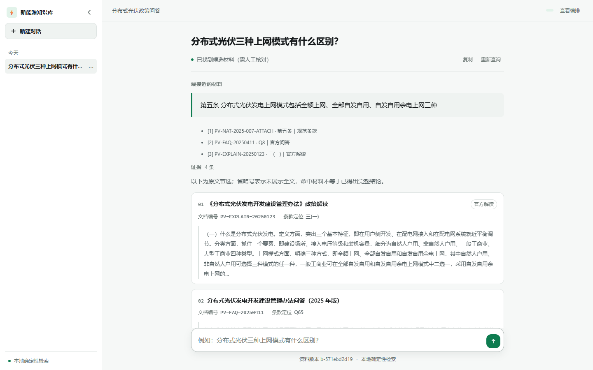
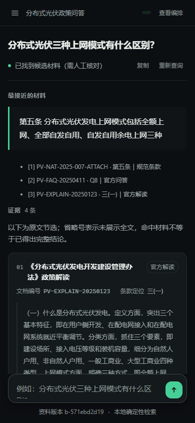

# 新能源知识库：分布式光伏政策证据工作台

**一句话**：把分布式光伏的公开政策原文、从里面提炼出的结论、以及能直接跑的判定规则放在一起——你查到的每个说法，都能点回原文里的某一句话。

这是个人学习与作品展示项目，目前只覆盖分布式光伏。仓库给你三样东西：能在自己电脑上跑起来的源码、定稿后不再改动的资料副本、真实界面截图。



## 先看这个：几个词是什么意思

这几个词在文档里会反复出现，先花 30 秒说明白。

- **冻结资料**：2026-11-14 从官网抓下来的一份副本，之后官网怎么改都不跟着变。好处是你现在跑的结果，和我当时看到的是同一份材料。
- **主张（claim）**：从政策里提炼出的一句话结论，后面挂着它成立的条件——适用地区、政策时点、是否需要看附件。
- **规则本体（ontology）**：把条款拆成「满足这几个字段 → 得出这个结论」的表格。填上项目的实际情况就能跑。
- **证据单元（unit）**：原文按条款切开的最小片段，每条都能定位回原文件的具体位置。

## 有多大、验到什么程度

| 项目 | 数量 |
| --- | --- |
| 政策来源 | 8 份：国家政策正文与附件、官方解读、问答，以及江苏、浙江、广东的实施文件与一份全国统一电力市场现货文件 |
| 证据单元 | 548 个；其中 244 个被判定为跨层等价，另有 144 条对应关系登记在映射表里 |
| 提炼出的主张 | 71 条 |
| 可执行规则 | 4 条 |
| 实体 / 事实 / 关系 | 7 / 5 / 13 |
| 项目字段 | 22 个（装机容量、并网电压、投资主体等） |

验证情况：网页端 18 项自动检查全过（真实浏览器 + 受控模拟接口），离线运行检查 5 项全过，本机真实 Dify 链路跑通三条演示问题。逐项明细和保留的限制见 [验证结果与限制](docs/VALIDATION.md)。

## 它能做什么

- **查原文**：提问后返回候选材料，每条带文档编号和条款位置，可以回查本地冻结原件。
- **读结论**：每条主张都带着适用条件、政策时点、事件时点；「官方未明确」这类状态也照实标出来，不和「本次没匹配到」混为一谈。
- **判项目**：给一份项目字段（22 个），按规则判定；字段缺失、规则未覆盖、条件冲突会分别说清楚是哪一种。
- **查影响**：沿着已建立的引用关系，看某条政策变化可能波及哪些规则。
- **网页对话**：本地 Dify 工作流调用本机工具，结果用模板渲染。本版不接大模型生成节点，所以不会出现模型编造答案的情况。

> 网页端负责展示材料检索；规则判定和影响追溯走命令行。两者是不同层次的输出，不要混着看。

## 最快运行：不需要 Dify，也不需要模型 Key

要求 Python 3.10+。本次导出在 Windows / Python 3.14、jieba 0.42.1 上验证过，其他平台尚未实测。

```bash
git clone https://github.com/1980c-L/new-energy-knowledge-base.git
cd new-energy-knowledge-base
python -m pip install -r requirements.txt
python -B tools/integration176/local176.py --store data/bundles query --question "并网可以附加保证电网安全必要技术要求吗" --mode knowledge --policy-as-of 2025-12-31
```

这条命令只在本地读冻结材料，不请求任何模型 API。输出里有主张、条件和原文引用。命中材料是一回事，问题是否被完整回答是另一回事。

```bash
# 区分「官方未明确」和「本次没有匹配」
python -B tools/integration176/local176.py --store data/bundles query --question "50千伏接入方案答复时限是多少" --mode knowledge --policy-as-of 2025-12-31

# 查看第五条相关的已建影响关系
python -B tools/integration176/local176.py --store data/bundles query --question "国家第五条变化影响哪些规则" --mode impact --node "ontology:PV-NAT-2025-007-ATTACH#clause=第五条"

# 无模型、无网络的导出运行检查
python -B -m unittest discover -s tests -p "test_*.py" -v
```

## 页面与架构

一句话说法：**网页 → Dify 工作流（拖拽编排，本版只挂模板和 HTTP 节点，不接大模型）→ 本机的一个小服务 → 冻结的原文和规则表**。

 

截图来自本地 Dify 的真实会话，是记录时的状态，不是已上线的网站。[接入与目录说明](docs/RUNNING.md) · [验证结果与限制](docs/VALIDATION.md)

## 如何阅读源码

| 入口 | 作用 |
|---|---|
| [`web/`](web/) | 零构建的 HTML/CSS/JavaScript 前端，外加一个本地小代理（把网页请求转给本机工具） |
| [`dify/chatflow.yml`](dify/chatflow.yml) | 无模型的对话工作流，HTTP 节点调用本地工具 |
| [`tools/integration176/`](tools/integration176/) | 统一查询、版本绑定、原文回查与 HTTP 适配 |
| [`tools/layer34_165/`](tools/layer34_165/) | 本地检索、证据组装与候选版本 |
| [`data/bundles/`](data/bundles/) | 冻结的政策原文、主张、规则和来源映射 |
| [`tests/`](tests/) | 离线运行检查，以及自动点一遍网页的检查脚本 |

## 边界与限制

- 资料是冻结版本，没有联网核实现行效力，适合看方法，不适合拿去做项目合规决策。
- 网页只展示原文节选（首批前四段，长段落会截断），页面上标了命中数量和未展示提示；完整材料用命令行看。
- 与政策无关的问题也可能返回候选材料——本版没有通用的语义拒答能力。
- 云模型生成答案的质量不在本版验收范围内；历史研究结论只代表当时的结论。
- 访问方式：公开源码与资料，不提供在线服务，免费公网部署已取消。本地运行、源码展示、长期在线服务是三件不同的事。

## AI 辅助开发与项目状态

需求、用途和取舍由我组织；CodeBuddy、DSH 与 Codex 辅助实现代码、整理资料、复验结果。前端由这两条线接续修改，是同一份代码链；仓库里保留的是复验后的展示版本。

这是个阶段性作品。后续如果继续做，优先级是先解决「问题范围识别」和「证据全文入口」，再考虑加生成能力。

公开政策材料与项目代码的使用说明见 [NOTICE](NOTICE.md)。
