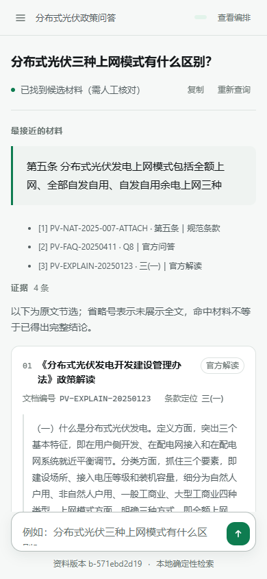

# 新能源知识库：分布式光伏政策证据工作台

把分布式光伏的公开政策原文、从中提炼的结论与可执行的判定规则放在一起。每个结论都能追溯回原文的条款位置。

仓库包含：本地可运行的源码、2026-11-14 冻结的资料副本、界面截图。覆盖范围：分布式光伏。


## 术语

- **冻结资料**：2026-11-14 从官网抓取的副本，不随后续官网更新变化，同一份材料可复现。
- **主张（claim）**：从政策中提炼的单条结论，附成立条件：适用地区、政策时点、是否依赖附件。
- **规则本体（ontology）**：把条款拆成「满足字段 → 得出结论」的判定表，输入项目字段即可运行。
- **证据单元（unit）**：原文按条款切分的最小片段，每条可定位到原文件的具体位置。

## 规模

| 项目 | 数量 |
| --- | --- |
| 政策来源 | 8 份：国家政策正文与附件、官方解读、问答，以及江苏、浙江、广东的实施文件与一份全国统一电力市场现货文件 |
| 证据单元 | 548 个；其中 244 个判定为跨层等价，144 条对应关系登记在映射表 |
| 提炼结论 | 71 条 |
| 可执行规则 | 4 条 |
| 实体 / 事实 / 关系 | 7 / 5 / 13 |
| 项目字段 | 22 个（装机容量、并网电压、投资主体等） |

网页端自动检查 18 项全部通过（真实浏览器 + 受控模拟接口）；离线运行检查 5 项通过；本机 Dify 链路完成三条演示问题。明细见 [验证结果与限制](docs/VALIDATION.md)。

## 功能

- **原文检索**：返回候选材料，附文档编号与条款位置，可回查冻结原件。
- **结论读取**：主张附适用条件、政策时点、事件时点；「官方未明确」与「本次未匹配」分别标注。
- **项目判定**：输入 22 个项目字段，按规则判定；字段缺失、规则未覆盖、条件冲突分别输出。
- **影响追溯**：沿已建立的引用关系，列出政策变化可能波及的规则。
- **网页对话**：本地 Dify 工作流调用本机工具，结果由模板渲染；工作流不含大模型节点。

网页端做材料检索展示；规则判定与影响追溯通过命令行完成。

## 运行（无需 Dify 与模型 Key）

要求 Python 3.10+。已在 Windows / Python 3.14、jieba 0.42.1 验证；其他平台未实测。

```bash
git clone https://github.com/1980c-L/new-energy-knowledge-base.git
cd new-energy-knowledge-base
python -m pip install -r requirements.txt
python -B tools/integration176/local176.py --store data/bundles query --question "并网可以附加保证电网安全必要技术要求吗" --mode knowledge --policy-as-of 2025-12-31
```

命令只读本地冻结材料，不请求模型 API。输出含主张、条件与原文引用；命中材料与问题是否被完整回答是两件事。

```bash
# 区分「官方未明确」与「本次没有匹配」
python -B tools/integration176/local176.py --store data/bundles query --question "50千伏接入方案答复时限是多少" --mode knowledge --policy-as-of 2025-12-31

# 查看第五条相关的已建影响关系
python -B tools/integration176/local176.py --store data/bundles query --question "国家第五条变化影响哪些规则" --mode impact --node "ontology:PV-NAT-2025-007-ATTACH#clause=第五条"

# 无模型、无网络的导出运行检查
python -B -m unittest discover -s tests -p "test_*.py" -v
```

## 架构

网页 → Dify 工作流（模板与 HTTP 节点，不含大模型）→ 本机 HTTP 服务 → 冻结原文与规则表

 

截图取自本地会话，非在线站点。[接入说明](docs/RUNNING.md) · [验证结果与限制](docs/VALIDATION.md)

## 源码结构

| 入口 | 内容 |
|---|---|
| [`web/`](web/) | 零构建 HTML/CSS/JavaScript 前端，附本地小代理（转发网页请求到本机工具） |
| [`dify/chatflow.yml`](dify/chatflow.yml) | 无模型对话工作流，HTTP 节点调用本地工具 |
| [`tools/integration176/`](tools/integration176/) | 统一查询、版本绑定、原文回查与 HTTP 适配 |
| [`tools/layer34_165/`](tools/layer34_165/) | 本地检索、证据组装与候选版本 |
| [`data/bundles/`](data/bundles/) | 冻结政策原文、主张、规则与来源映射 |
| [`tests/`](tests/) | 离线运行检查与网页自动检查脚本 |

## 限制

- 资料为 2026-11-14 冻结版本，未联网核实现行效力，不构成项目合规依据。
- 网页展示原文节选（首批前四段，长段落截断），页面标注命中数量与未展示提示；完整材料通过命令行查看。
- 与政策无关的问题也可能返回候选材料，无通用语义拒答。
- 云模型生成答案的质量不在本版验收范围内。
- 仓库只发布源码与展示资料，不含在线服务。

公开政策材料与项目代码的使用说明见 [NOTICE](NOTICE.md)。
